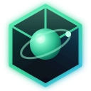
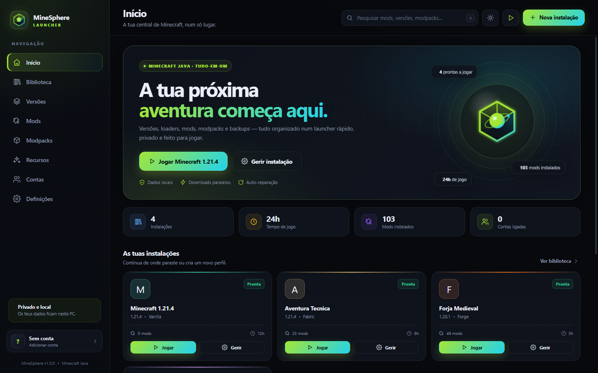
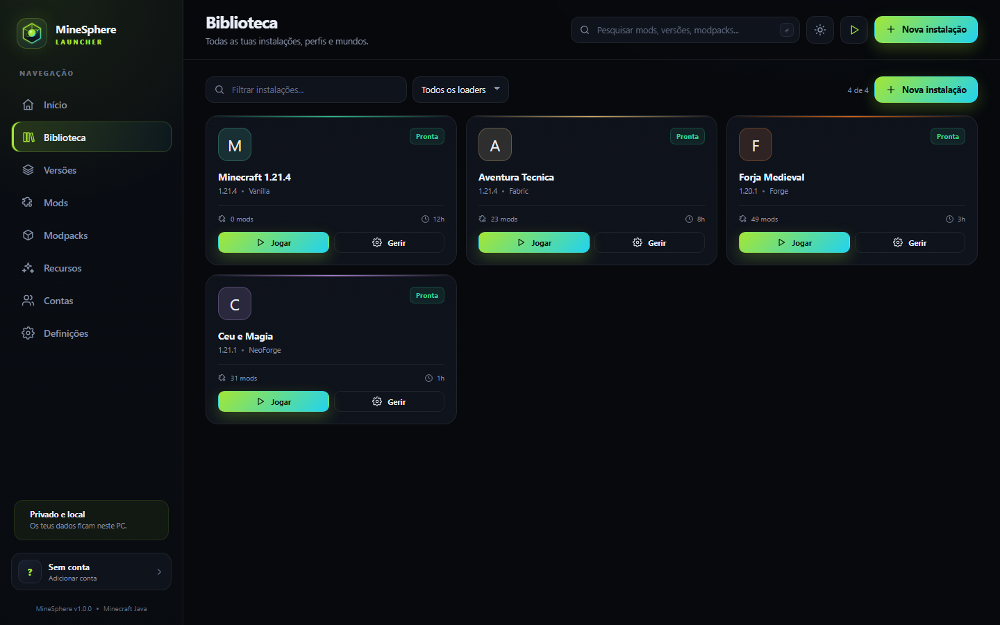
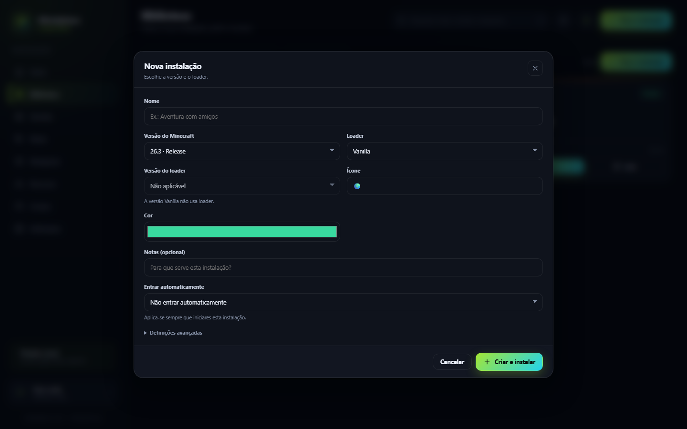
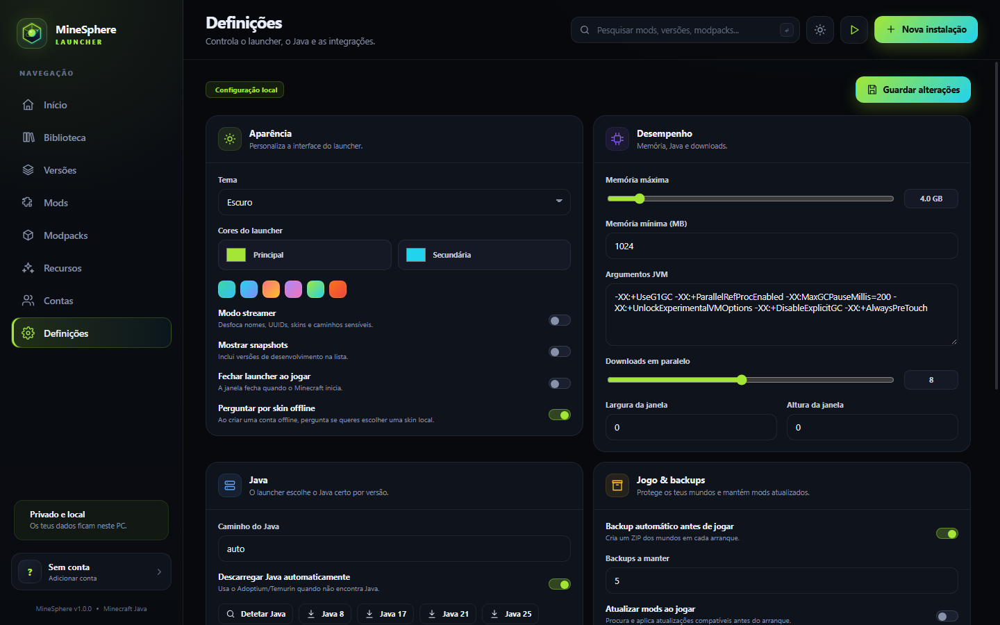

<div align="center">
  
  <h1>MineSphere Launcher</h1>
  <p><strong>Launcher local e open source para Minecraft Java Edition.</strong></p>
  <p>Contas, skins, loaders, mods, modpacks, backups e Java automático — <strong>sem instalar Node.js</strong>.</p>
  <p>
    <a href="https://github.com/MundumIgnotum/MineSphere-Launcher/blob/main/LICENSE"></a>
    <a href="https://github.com/MundumIgnotum/MineSphere-Launcher"></a>
    <a href="https://nodejs.org/"></a>
    <a href="https://www.microsoft.com/windows/"></a>
  </p>
  <p>
    <a href="https://mundumignotum.github.io/MineSphere-Launcher/"><strong>Website</strong></a> ·
    <a href="https://github.com/MundumIgnotum/MineSphere-Launcher/archive/refs/heads/main.zip"><strong>Download ZIP</strong></a> ·
    <a href="https://github.com/MundumIgnotum/MineSphere-Launcher/releases">Releases</a> ·
    <a href="https://github.com/MundumIgnotum/MineSphere-Launcher/issues">Issues</a>
  </p>
</div>

> [!IMPORTANT]
> **Projeto independente e não afiliado.** O MineSphere Launcher **não é afiliado, associado, autorizado ou patrocinado pela Microsoft Corporation ou pela Mojang Studios**. Minecraft é uma marca registada da Mojang Studios. Este projeto é apenas uma aplicação **open source** e não inclui assets, texturas, sons ou código proprietário do jogo. Para jogar, precisas de uma conta Minecraft legítima.



## O que é

O **MineSphere Launcher** é uma aplicação local, feita em **Node.js puro e sem dependências externas**, para gerir e iniciar o Minecraft Java Edition. A interface corre no browser, mas o servidor escuta apenas em `127.0.0.1`; os teus dados ficam no teu computador.

O launcher reúne contas Microsoft e offline, skins, todas as versões do manifesto oficial, Fabric, Quilt, Forge, NeoForge, mods, modpacks, resource packs, shaders, datapacks, backups, capturas e Java automático.

## Destaques

- **Sem instalar Node.js:** no Windows, o `start.bat` descarrega um runtime portátil na primeira execução, com verificação SHA-256.
- **Contas Microsoft e offline:** login por device code e perfis locais com UUID determinístico.
- **Skins:** envio oficial para contas Microsoft e skins locais para contas offline, com sincronização opcional para CustomSkinLoader.
- **Cinco loaders:** Vanilla, Fabric, Quilt, Forge e NeoForge.
- **Conteúdo:** mods do Modrinth, CurseForge e GitHub, modpacks, resource packs, shaders e datapacks.
- **Backups:** cópias automáticas e manuais dos mundos, restauro e capturas de ecrã.
- **Java automático:** deteção local e download de Adoptium/Temurin (Java 8, 17, 21 e 25).
- **Entrada automática:** servidor ou mundo por instância, com suporte a quick play no Minecraft 1.20+.
- **Interface personalizável:** tema claro/escuro, cores, modo streamer, memória, resolução e argumentos JVM.
- **Local e privado:** sem telemetria própria; os tokens ficam em `data/accounts.json` no teu PC.

## Capturas

| Início | Biblioteca |
| --- | --- |
|  |  |
| **Nova instalação** | **Definições** |
|  |  |

O website do projeto está em **[mundumignotum.github.io/MineSphere-Launcher](https://mundumignotum.github.io/MineSphere-Launcher/)** e a fonte da página está em [`docs/`](docs/).

## Requisitos

- **Windows 10/11** para a experiência completa com `start.bat` e backups de mundos via PowerShell.
- **Ligação à Internet** para descarregar versões, bibliotecas, loaders, conteúdo e o runtime Node.js inicial.
- **Conta Minecraft legítima** para jogar online e para o login Microsoft.
- Cerca de **100 MB livres** para o runtime Node.js portátil, na primeira execução no Windows.
- Node.js **18.17 ou superior** apenas se quiseres arrancar manualmente noutro sistema ou sem o `start.bat`.

Não é necessário executar `npm install`: o projeto não tem dependências externas.

## Download e instalação

1. Descarrega o **[ZIP do projeto](https://github.com/MundumIgnotum/MineSphere-Launcher/archive/refs/heads/main.zip)** ou uma versão em **[Releases](https://github.com/MundumIgnotum/MineSphere-Launcher/releases)**.
2. Extrai para uma pasta com permissão de escrita.
3. No Windows, faz duplo clique em **`start.bat`**.
4. Na primeira execução, o launcher procura um Node.js compatível. Se não encontrar, descarrega automaticamente um runtime portátil para `runtime/node/` (cerca de 100 MB, a partir de `nodejs.org`, com verificação SHA-256).
5. Adiciona uma conta, cria uma instalação e prime **Jogar**.

Para arrancar sem abrir o browser:

```powershell
.\start.bat --no-open
```

Porta personalizada:

```powershell
$env:MINESPHERE_PORT = "48000"
.\start.bat
```

Se já tiveres Node.js 18.17+:

```powershell
node server.js
```

O servidor escuta apenas em `127.0.0.1` e abre a interface numa janela do Edge/Chrome em modo aplicação. Mantém a janela do terminal aberta enquanto usares o launcher. Fecha-a ou prime `Ctrl+C` para terminar.

## Contas

### Offline

Em **Contas → Adicionar conta offline**, escolhe um nome. É criada uma conta local com UUID determinístico e ativada automaticamente.

### Microsoft

O login usa **device code** e suporta dois formatos de Client ID:

- **ID público de 16 caracteres** (predefinido: `00000000402b5328`): usa o fluxo Live Connect v1 em `login.live.com`. Não precisas de criar uma app Azure. O endpoint de device code foi validado; a Microsoft pode alterar ou revogar IDs públicos.
- **UUID de app Azure**: usa o Microsoft Entra v2 em `login.microsoftonline.com/consumers`. Cria uma app com suporte para **contas pessoais Microsoft** e ativa **Allow public client flows**:
  1. Abre o [Portal do Azure](https://portal.azure.com/) → **Microsoft Entra ID → Registos de aplicações → Novo registo**.
  2. Escolhe uma conta com suporte para **contas pessoais Microsoft**.
  3. Em **Autenticação**, ativa **Allow public client flows**.
  4. Copia o **Application (client) ID**.
  5. Em **Definições → Integrações → Microsoft Client ID**, cola o UUID e guarda.
  6. Em **Contas → Adicionar conta Microsoft**, segue o código e a página indicados.

O fluxo v1 pede o escopo `service::user.auth.xboxlive.com::MBI_SSL`; o v2 pede `XboxLive.signin offline_access`. A conta Microsoft tem de ter uma conta Xbox Live válida.

> [!WARNING]
> Os tokens de sessão são guardados em texto simples em `data/accounts.json`. Não uses este launcher em computadores partilhados e protege a pasta `data`.

### Skins

Em **Contas → Skin** podes escolher uma skin:

- **Contas Microsoft:** o PNG 64×64 é enviado para a Minecraft Services com o modelo clássico ou fino. A alteração fica associada à conta oficial e aparece nos servidores.
- **Contas offline:** o PNG fica guardado em `data/skins/` e é usado no launcher. Podes copiá-lo para `CustomSkinLoader/LocalSkin/skins/<nome>.png` em todas as instâncias com a opção de sincronização. Ao removeres a skin local, as cópias sincronizadas também são apagadas.

A skin local de uma conta offline **não altera a skin vista por outros jogadores**. O CustomSkinLoader só a mostra no teu cliente, e tem de estar instalado na instância. Para skins partilhadas seria necessário um sistema/plugin no servidor.

Ao criar uma conta offline, o launcher pergunta se queres escolher uma skin. Podes desativar essa pergunta em **Definições → Aparência**.

## Entrada automática

Cada instalação pode entrar automaticamente num servidor ou abrir um mundo ao iniciar:

- **Servidor:** usa `--server` e, quando não é 25565, `--port`.
- **Mundo:** usa `--quickPlaySingleplayer` e requer Minecraft **1.20 ou superior**. Indica o nome da pasta em `saves`, não o nome visível no jogo.

Configura em **Biblioteca → instalação → Editar → Entrar automaticamente**. A opção é guardada por instalação.

## Funcionalidades

- Instalação de qualquer versão `release`, snapshot, RC, beta ou alpha do manifesto oficial.
- Loaders: Vanilla, Fabric, Quilt, Forge e NeoForge.
- Deteção de Java e download automático de Adoptium/Temurin (Java 8, 17, 21 e 25).
- Contas Microsoft via device code e contas offline.
- Skins oficiais Microsoft e skins locais offline com sincronização opcional para CustomSkinLoader.
- Entrada automática por instância num servidor ou mundo (Minecraft 1.20+).
- Pesquisa e instalação de mods no Modrinth, CurseForge e releases do GitHub.
- Modpacks do Modrinth, importação de `.mrpack`/`.zip` e exportação.
- Resource packs, shaders e datapacks por instância/mundo.
- Backups automáticos e manuais de mundos, restauro e capturas de ecrã.
- Reparação de instalações, logs, argumentos JVM, memória e resolução por instância.
- Exportação/importação de configuração e sincronização por pasta.
- Interface em português, tema claro/escuro, cores personalizáveis e modo streamer.
- Janela em modo aplicação.
- Runtime Node.js portátil automático no Windows.

## CurseForge

A pesquisa e instalação pela CurseForge requer uma **API key** gratuita. Obtém uma em [console.curseforge.com](https://console.curseforge.com/) e cola-a em **Definições → Integrações → CurseForge API key**. Modrinth funciona sem chave.

## Estrutura do projeto

```text
server.js              servidor HTTP local
src/                   backend Node.js (contas, instâncias, loaders, mods, backups, API)
public/                interface web (HTML, CSS e JavaScript)
tools/ensure-node.ps1  download e verificação do Node.js portátil
docs/                  website estático para GitHub Pages
data/                  definições, contas, skins e instalações (ignorado pelo Git)
game/                  versões, bibliotecas e assets partilhados (ignorado pelo Git)
instances/<id>/        ficheiros de cada instalação (ignorado pelo Git)
runtime/java/<major>/  Java descarregado pelo launcher (ignorado pelo Git)
runtime/node/          Node.js portátil descarregado pelo launcher (ignorado pelo Git)
```

Os backups ficam em `instances/<id>/backups/`. As capturas ficam em `instances/<id>/screenshots/`.

Para apagar uma instalação sem remover os ficheiros do disco, desmarca **Apagar também os ficheiros** no diálogo de remoção.

## Desenvolvimento

O projeto não usa bundler, framework nem dependências de runtime. Para trabalhar no backend:

```powershell
node server.js
```

Para trabalhar apenas na interface, abre `public/` através do servidor; não abras `public/index.html` diretamente, porque a app precisa da API local.

Verificação de sintaxe:

```powershell
node --check server.js
node --check public/js/app.js
node --check src/api.js
node --check src/skins.js
node --check src/launch.js
node --check src/instances.js
node --check src/store.js
node --check src/auth.js
```

Ou, se tiveres npm disponível:

```powershell
npm run check
```

## Website

O website é estático e vive em [`docs/`](docs/). Para o testar localmente, podes servir essa pasta com qualquer servidor HTTP, por exemplo:

```powershell
node -e "const h=require('http'),f=require('fs'),p=require('path');h.createServer((q,s)=>{let u=q.url==='/'?'/index.html':q.url;f.readFile(p.join('docs',u),(e,d)=>{if(e){s.writeHead(404);return s.end()}s.end(d)})}).listen(8080)"
```

Depois abre `http://127.0.0.1:8080/`.

O workflow [`.github/workflows/pages.yml`](.github/workflows/pages.yml) publica a pasta `docs/` no GitHub Pages a cada push para `main`.

## Limitações conhecidas

- **LiteLoader** não é instalado automaticamente; a interface devolve uma mensagem de erro.
- O fluxo Microsoft v1 com o ID público foi validado até ao device code; a troca Xbox Live/Minecraft exige uma conta real e pode ser limitada pela Microsoft.
- O envio oficial de skins exige uma conta Microsoft real e ainda não foi testado neste ambiente.
- Skins offline são locais: não são visíveis para outros jogadores. O CustomSkinLoader tem de estar instalado em cada instância e só afeta o teu cliente.
- A entrada automática num mundo requer Minecraft 1.20+ e o nome da pasta do mundo em `saves`.
- O modo streamer é uma proteção visual (desfoca dados sensíveis); não remove os valores do DOM nem dos ficheiros locais.
- O download automático de Java 17/25, Fabric e Forge foram validados localmente; NeoForge e ambientes com firewall/proxy continuam por testar.
- Se o antivírus ou firewall bloquear o download do runtime Node.js, permite `runtime/node/node.exe` ou instala Node.js 18.17+ manualmente.
- Os backups usam PowerShell no Windows. Noutros sistemas, o fluxo de backup pode não estar disponível.
- Não há encriptação de tokens nem gestor de segredos.
- O servidor é local e não deve ser exposto à Internet.
- O download automático do Node.js portátil é específico para Windows. Noutros sistemas, usa Node.js 18.17+ e `node server.js`.

## Privacidade e segurança

- O servidor escuta apenas em `127.0.0.1`.
- As contas, definições, skins e instâncias ficam em `data/`, `game/`, `instances/` e `runtime/`, pastas ignoradas pelo Git.
- Não há telemetria própria. O launcher contacta os serviços oficiais da Mojang/Microsoft, Modrinth, CurseForge, GitHub e `nodejs.org` para descarregar o que pedes.
- Os tokens Microsoft são guardados em texto simples. Protege a pasta `data/` e não uses o launcher em computadores partilhados.
- O website não recolhe dados pessoais e não usa cookies de análise.

## Contribuir

Contribuições são bem-vindas. Lê o [`CONTRIBUTING.md`](CONTRIBUTING.md) e abre um [issue](https://github.com/MundumIgnotum/MineSphere-Launcher/issues) para bugs, sugestões ou dúvidas. Antes de enviares uma alteração, corre as verificações de sintaxe e descreve o que testaste.

## Licença

O código do MineSphere Launcher está disponível sob a **[licença MIT](LICENSE)**.

O runtime Node.js descarregado pelo launcher tem a sua própria licença, incluída em `runtime/node/LICENSE` quando é instalado. O Minecraft, os seus assets e os serviços da Mojang/Microsoft não fazem parte deste repositório e estão sujeitos às licenças e termos dos respetivos proprietários.

## Aviso legal

**MineSphere Launcher não é afiliado, associado, autorizado ou patrocinado pela Microsoft Corporation ou pela Mojang Studios.** Minecraft é uma marca registada da Mojang Studios. Este projeto é uma aplicação independente e open source, sem qualquer relação oficial com a Microsoft ou a Mojang.

O projeto não inclui nem distribui assets, texturas, sons, bibliotecas ou código proprietário do Minecraft. Os ficheiros do jogo são obtidos a partir dos serviços oficiais da Mojang quando o utilizador os descarrega. Para jogar, é necessária uma conta Minecraft legítima.

Consulta também [`NOTICE.md`](NOTICE.md).
